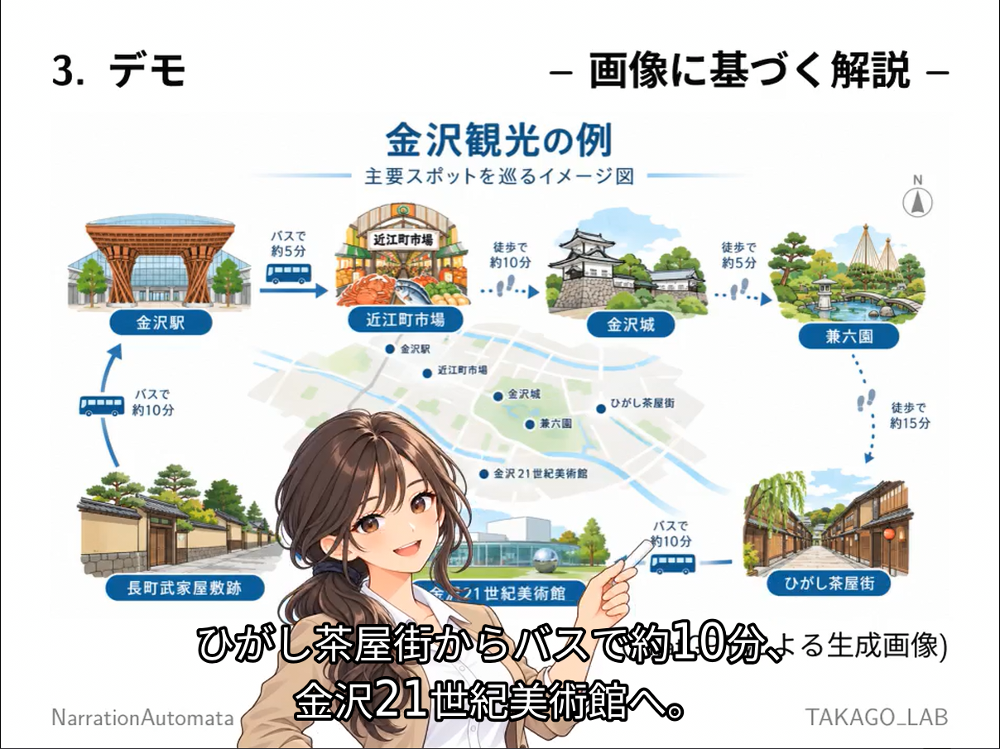
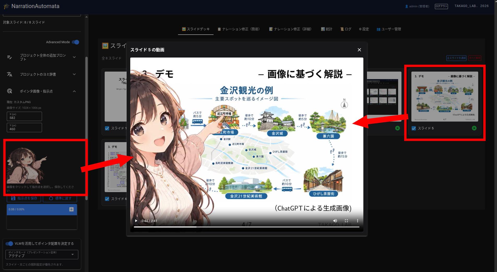

# NarrationAutomata

> 当初は「slide-narrator」という名称で公開しましたが，同名のサービスが既に存在することが判明したため，混同を避ける目的で，リポジトリ名およびソフトウェア名を「NarrationAutomata」に変更しました．

**Turn PDF slides into narrated videos automatically with AI.**

講義や研究発表用のPDFスライドから，ナレーション音声，日本語・英語字幕，レーザーポインタ風の視線誘導を備えた動画を自動生成するシステムです．オンデマンド教材や研究発表動画の制作を想定しています．CLIとNiceGUIベースのWebUIを提供します．

## 主な機能

- **PDFから動画を全自動生成**：講義／研究発表の発表スタイルと，日本語／英語のナレーション言語を選択できます．
- **日本語・英語字幕**：主言語の字幕と翻訳字幕を生成し，対応するプレーヤで字幕表示を切り替えられる形で動画に収録します．
- **視線誘導**：ナレーションの内容に合わせてレーザーポインタ風マーカーを配置します．カスタムPNG画像によるポインタ表示にも対応します．PDF由来のテキスト・図形位置と，必要に応じたVLMによるスライド内要素の位置検出（Bbox）を利用します．検出や対応付けの精度は保証されません．アクティブポインタモードでは説明対象の位置に合わせてマーカーが動きます（実験的機能）．
- **編集機能**：生成されたナレーション原稿，プロジェクト全体／スライド別の追加指示，TTS用ヨミ辞書などを編集できます．
- **TTSヨミ変換**：日本語音声合成の前に，技術用語，コマンド，識別子などをLLMとヨミ辞書で読みやすく変換します．
- **Easy / Advancedモード**：Easyは全自動生成を中心に，Advancedは工程別の操作や編集・詳細確認に利用します．生成中は進捗状況を確認できます．
- **生成統計**：スライドごと・処理ごとのAIの思考文字数，回答文字数などを積み上げ棒グラフで可視化します．スライド画像のホバープレビュー，共通／個別の縦軸スケール，Excel（`.xlsx`）出力に対応します．
- **ローカル運用**：OpenAI互換APIを持つLLM・TTSサーバをローカルで動かせば，処理をローカル環境に閉じることができます．
- **複数ユーザ・プロジェクト管理**：WebUIではユーザごとにプロジェクトを管理できます．生成ジョブはログアウト後もバックグラウンドで継続可能です．重い生成処理は同時実行を制限し，実行中の他ユーザの要求は待ち行列に入れず拒否します．管理者はユーザの利用可能期間を設定できます．

## VLMによるポインタ位置の追加調査（実験的機能）

複雑な図などで通常の要素検出だけでは指示先が曖昧な場合，LLMが追加調査の必要性を判断し，質問を生成してVLMに対象位置（bbox）を再確認できます．必要な場合のみ最大1回VLMを呼び出し，有効な領域が得られた文だけポインタ位置を再選定します．**Advanced Modeのスイッチで有効化し，初期値はOFF**です．追加調査の推論設定は管理者設定の通常のLLMと共通です．処理負荷が増える場合があり，位置精度の改善は保証されません．詳しくは [ポインタモード](POINTER_MODES.md) を参照してください．

## スクリーンショット

### WebUI（画面例 1）

<table>
<tr><td>

</td></tr>
</table>

---
### WebUI（画面例 2）

<table>
<tr><td>

</td></tr>
</table>

---

### WebUI（画面例 3）

<table>
<tr><td>

</td></tr>
</table>


> 画面は開発中のものです．最新版と異なる場合があります．

## 生成パイプライン：入力と出力

内部ではPDFのテキスト抽出・画像化を行ったうえで，以下の①〜④を実行します．**「LLM」「VLM」はモデルの分類を表す言葉ですが，ここでは処理目的に沿って工程を説明します．** 例えば，ナレーション生成もスライド画像を入力するため，画像を扱えるモデルの機能を利用します．「Bbox検出」だけが画像を扱う処理というわけではありません．

### 前処理（PDFの解析・講義全体の概要把握）

| 処理 | 入力 | 出力 |
| --- | --- | --- |
| PDF画像化・テキスト抽出 | PDFファイル | スライドごとの画像，抽出テキスト |
| 講義概要生成 | 全スライドのPDF抽出テキスト | 講義・発表全体の概要テキスト |

講義概要生成では**PDFから抽出したテキストをLLMに渡します**．この段階ではVLMによるスライド画像解析は行いません．

### ① ナレーション原稿の生成

| 入力 | 出力 |
| --- | --- |
| 現在のスライド画像，PDF抽出テキスト，講義全体の概要，前後のスライドのテキスト，直前のナレーション，発表スタイル・言語，必要に応じた追加プロンプト | 各スライドのナレーション原稿（テキスト） |

スライド画像と文章の両方をモデルに与え，単なる読み上げではなく，前後の流れを踏まえた説明文を作成します．**ここでも画像理解を伴います**．

### ② 翻訳・字幕情報・ポインタ位置の作成

この工程には複数の異なるAI処理が含まれます．

| 処理 | 入力 | 出力 |
| --- | --- | --- |
| Bbox検出（必要に応じて実行） | スライド画像 | 図表・数式・図内部品などの要素名，種類，位置座標（Bbox） |
| PDF要素抽出 | PDFの該当ページ | PDF由来の文字，コード行，図・画像領域と位置情報 |
| ポインタ位置選定 | ナレーションの文，スライド画像，PDF・VLM由来の要素一覧 | ナレーション各文と対象要素の対応関係 |
| 字幕用翻訳 | ナレーションの文 | もう一方の言語に翻訳した字幕テキスト |

Bbox検出は，ポインタ候補となる視覚要素の位置を求める処理です．**ナレーションのどの文で何を指すかを決める「ポインタ位置選定」とは別の処理**です．VLMによる要素検出を使わず，PDF構造を基準にする設定もあります．

### ③ ナレーション音声の作成

| 処理 | 入力 | 出力 |
| --- | --- | --- |
| TTSヨミ変換（日本語の場合） | ナレーション原稿，共通・プロジェクト別ヨミ辞書 | TTSに渡す読み上げ用テキスト |
| TTS音声合成 | 読み上げ用テキスト（英語の場合は元の原稿），TTS設定 | スライドごとの音声ファイル |

ヨミ変換は内容の要約や翻訳ではなく，読み間違いやすい技術表記を自然な発音に整えるための処理です．対応するTTSサーバを使用することで，参照音声を利用した音声合成も可能です．

### ④ ナレーションビデオの作成

| 入力 | 出力 |
| --- | --- |
| スライド画像，生成音声，字幕情報，ナレーション文と要素の対応関係，動画設定 | スライドごとの動画，結合された最終動画，日本語・英語字幕，チャプター情報など |

FFmpegを使って画像，音声，字幕，ポインタ表示を統合し，対象スライドを1本の動画に結合します．

### 処理の流れ

```text
PDF
 ├─ ページ画像化 ───────────────────────────┐
 └─ PDFテキスト抽出 ──→ 講義概要生成        │
                    │                      │
                    └──→ ① ナレーション生成 ←┘
                                │
                                ▼
               ② PDF要素抽出＋必要に応じたBbox検出
                  ├─ ポインタ位置選定
                  └─ 字幕用翻訳
                                │
                                ▼
                    ③ TTSヨミ変換・音声合成
                                │
                                ▼
                  ④ FFmpegによる動画作成・結合
                                │
                                ▼
                  音声・字幕付きスライド動画
```

## リファイナーと再生時間の調整

- **リファイナー**：ナレーションの品質をルール・LLMの検査で確認し，必要な箇所を再生成・自動校正・手動編集できます．検査結果と差分は「リファイナー」タブで確認します．管理設定によって全自動生成に組み込まれる場合があります．自動リファイナーは1回実行で，必要なら手動で再実行します．
- **再生時間の調整**：目標時間を指定し，ナレーションを短縮した新規プロジェクトを作成して音声・動画を生成する機能です．短縮の結果や所要時間の比較は「再生時間の調整」タブで確認します．「統計」タブとは役割が異なります．
- **中断と実行状態**：ジョブはサーバ側で進行し，ブラウザのログアウト後も継続できる構造です．同時に実行可能な重いジョブは1件で，待機キューはありません．中断後のジョブ切替はジョブIDと所有権で保護します．

## WebUIの画面構成

| 画面 | 主な用途 |
| --- | --- |
| スライドデッキ | PDFスライドの確認と対象ページの選択 |
| ナレーション一覧 | 複数スライドの原稿を一覧で確認・編集 |
| ナレーション編集 | スライド別の原稿，追加指示，字幕，ポインタ情報の編集 |
| リファイナー | 品質検査，差分確認，再生成，自動校正 |
| 再生時間の調整 | 目標時間に合わせた原稿調整と結果確認 |
| 統計 | AI処理量，工程別統計，Excel出力 |
| ログ | 処理ログとエラーの確認 |
| 設定・ユーザー管理 | 管理者向けのモデル設定，辞書，利用権限など |

Easy / Advancedモードによって利用可能なタブと操作が異なります．完成ビデオのリンクはサイドバーから取得します．

## ジョブ管理とデータ保存

- `job_manager.py`：実行ジョブID，所有権，排他制御，中断要求を管理します．ディスクへは保存しません．
- `job_state_view.py`：実行状態と保存状態を分け，UI向けの読み取り専用スナップショットを作成します．
- `sidebar_display.py`：進捗カードの候補選択と動画更新の判定に利用します．
- `validation/refine_job.py`：リファイナーの実行登録と状態ファイルを管理します．
- `.job_status.json`：ユーザー別の通常パイプラインの記録．`content_job.json` / `time_job.json`：プロジェクト別のリファイナー状態．

旧バージョンの平文パスワード，旧統計ログ，旧アライメント，複数回の時間調整結果などとの互換性は保証しません．現在のバージョンで新規作成したデータの利用を前提とします．

詳しくは [WebUIの内部構造](app.md)，[品質検査](validation/README.md) を参照してください．

## 統計タブについて

統計タブは，**モデルの種類ではなく処理目的ごと**にAIの出力傾向を観察するための機能です．表示項目は次のとおりです．

| グラフ | 計測対象 |
| --- | --- |
| ナレーション生成（画像・テキスト解析） | スライド画像・テキストからナレーションを作成する際のモデル出力 |
| Bbox検出（スライド要素の位置検出） | 要素の名称・種類・座標を検出する際のモデル出力 |
| 字幕用翻訳 | 字幕翻訳の際のモデル出力 |
| ポインタ位置選定 | ナレーションとスライド要素の対応付けの際のモデル出力 |
| TTSヨミ変換 | 日本語の読み上げ用テキストへの変換時のモデル出力 |

各グラフは，**思考文字数・回答文字数**と，取得できる場合の**入力・出力トークン数**を切り替えて確認できます．入力プロンプトの文字数やTTSの発話文字数を示すものではありません．思考文字数はAPIが思考テキストを返す場合に計測され，表示される値が推論の質や難易度を直接表すものではありません．

グラフにマウスを重ねると該当スライドの画像を確認でき，各タイトル横の情報アイコンからその処理の入力・出力・目的を参照できます．縦軸の共通／個別スケールを切り替えられ，共通スケールでは上限値も指定できます．統計データはExcel（`.xlsx`）でも取得できます．

統計は処理呼び出し単位で記録されます．グラフでは，原則として各スライド・各処理の最新の成功記録を表示します．したがって，過去の全実行回数を合算した負荷ではありません．特定のスライド番号を持たない「講義概要生成」はスライド別グラフに含まれません．また，データが再利用され，モデル呼び出しが行われない場合には新しい統計記録が増えないことがあります．

## セットアップ（Linux）

Python，Git，FFmpegを利用します．以下は `uv` を用いた一例です．

```bash
sudo apt install ffmpeg git

git clone --depth 1 https://github.com/takago/NarrationAutomata.git
cd NarrationAutomata

curl -LsSf https://astral.sh/uv/install.sh | sh
uv venv -p 3.10 .venv
source .venv/bin/activate
uv pip install -r requirements.txt
```

OpenAI互換エンドポイントを持つLLM・TTSサーバを用意してください．必要に応じて `config.yaml`，`tts_filter.yaml` を設定します．LLM・TTS関連の設定はWebUIからも変更できます．

### 使用環境の例

以下は開発者による使用例であり，必須構成ではありません．モデルやVRAMの必要量は設定により異なります．

- LLMサーバ：[Ollama](https://ollama.com/) ＋ [Qwen3.8-27B](https://huggingface.co/Qwen/Qwen3.8-27B)（RTX 5090）
- 日本語TTS：[Irodori-TTS-Server](https://github.com/Aratako/Irodori-TTS-Server)（参照音声の使用条件は音源ごとに確認してください）
- 英語TTS：[Kokoro-FastAPI](https://github.com/remsky/Kokoro-FastAPI)

## 起動（WebUI）

```bash
python3 app.py
```

ブラウザで `http://localhost:17171` にアクセスしてログインします．初期設定の管理者アカウントが残っている場合は，運用開始前にパスワードを変更してください．

ログイン後，PDFをアップロードし，発表スタイル（講義／研究発表）と主言語（日本語／英語）を選択します．Easyモードでは「全自動生成」を押すと，各工程を順番に実行します．Advancedモードでは工程別の実行や生成結果の確認・編集ができます．統計タブでは処理別グラフを確認できます．

管理者以外のユーザには管理者向け設定・ユーザ管理機能を公開しません．複数ユーザで利用する場合は，利用権限と生成ジョブの排他制御に注意してください．

## 起動（CLI）

```bash
python3 slide_lecture.py path/to/slides.pdf
```

主なオプションの例：

```bash
python3 slide_lecture.py path/to/slides.pdf --mode lecture --lang ja
python3 slide_lecture.py path/to/slides.pdf --mode research --lang en
python3 slide_lecture.py path/to/slides.pdf --pages 1-10,12
python3 slide_lecture.py path/to/slides.pdf --visual-mode pdf
python3 slide_lecture.py --help
```

`--visual-mode vlm` はVLMによるBbox検出を併用し，`--visual-mode pdf` はPDF構造に基づく要素情報を使います．その他のオプションは `--help` または [slide_lecture.md](slide_lecture.md) を参照してください．

## ライセンス（License）

本プロジェクトは **GNU General Public License v3.0（GPLv3）** の下で公開します．詳細は [LICENSE](LICENSE) を確認してください．


## 画像素材（Image Assets）

本リポジトリに含まれる [`pointing_lecturer.png`](pointing_lecturer.png) は，OpenAIのChatGPTによる画像生成機能を使用して制作したAI生成画像です．NarrationAutomataのカスタムポインタ画像として利用するために収録しています．

この画像について，リポジトリ管理者は利用・改変・再配布を認める意図で公開しています．ただし，AI生成画像には著作権が成立しない場合があり，独占的権利や第三者の権利を侵害しないことを保証するものではありません．ソフトウェア本体のGPLv3とは区別して，画像素材であることを明示しています．

The [`pointing_lecturer.png`](pointing_lecturer.png) character artwork was generated using OpenAI's ChatGPT image generation functionality. It is included as an optional custom pointer image for NarrationAutomata.

The repository maintainer intends to permit use, modification, and redistribution of this image. However, copyright protection, exclusive ownership, and non-infringement of third-party rights are not guaranteed for AI-generated artwork. This image is identified separately from the GPLv3-licensed software.


## TTSモデル・Voice別の音声キャッシュ（2026-10）

- 生成音声はプロジェクト内の `audio/<モデル名>_<voice名>_<識別ハッシュ>/<ページ番号>.mp3` に保存します．モデル名やvoice名に特殊文字があっても安全なパスに正規化し，識別ハッシュで名前の衝突を防ぎます．
- TTSモデル・voice・接続先や生成設定，ナレーション本文，管理者のヨミ設定とプロジェクトのヨミ辞書に基づいて生成条件のハッシュを保存します．一致する既存MP3だけを再利用します．従来のメタデータのないMP3は無条件に再利用せず，新方式で一度生成します．
- ④を実行すると，使用するTTS設定で音声キャッシュを確認します．音声が必要なときは③から実行し，MP3更新に応じてページ動画・完成動画も現在の生成条件で再生成します．音声の長さが変わっても字幕・ポインタのタイミングは動画工程で計算し直します．
- 動画も，音声・画像・アライメント等に基づくキャッシュ署名を記録します．既存の動画があっても生成条件が一致しない場合は再生成します．完成MP4はFFmpegが一時ファイルに正常出力した後で置き換えるため，生成失敗時には既存ファイルが残ります．
- ヘッダー右側に設定上の `LLM`，`VLM`，`TTS/Voice` を表示します．使用するモデル名が長い場合は省略表示し，ツールチップで全文を確認できます．管理者の基本設定を保存すると表示内容も更新します．
- ファイルを削除して作り直す必要はありません．明示的な「生成データを削除」では音声キャッシュも削除対象です．
