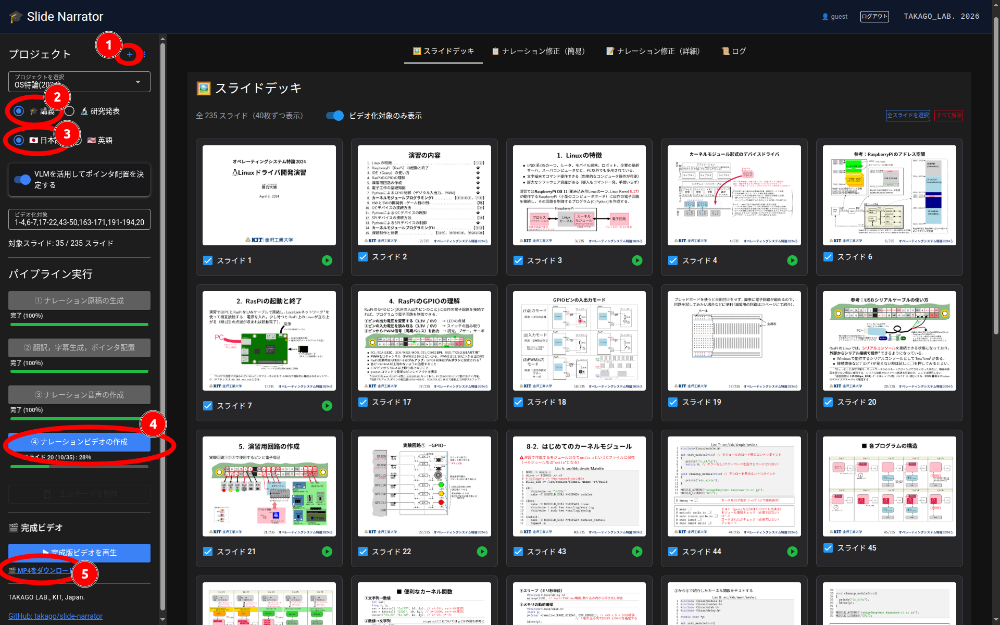

# slide-narrator

Turn PDF slides into narrated videos automatically with AI.

> **Note:** I chose the name `slide-narrator` when I created this repository, and only later discovered that several unrelated projects and packages use the same name. This project is independent of those projects.
>
> **注意:** 本リポジトリ作成後に，同じ `slide-narrator` という名前を使用している無関係のプロジェクトやパッケージがいくつか存在することに気付きました．本プロジェクトはそれらとは独立したものです．

`slide-narrator` は，講義や研究発表用の**PDFスライドからナレーション付き動画を作成するシステム**です．日英字幕の生成，レーザーポインタ風マーカーによる視線誘導，原稿の手動編集に対応します．CLIとNiceGUIベースのWebUIを利用できます．


*スクリーンショットは開発中の画面です．現在のUIとは一部異なる場合があります．*

## 主な機能

- **講義／研究発表モード**：目的に応じてナレーションの語り口を切り替えます．
- **日本語／英語の主言語**：スライドの記述言語に関係なく，指定した主言語で音声を生成します．他方の言語の字幕も生成します．
- **日英字幕**：日英の字幕を最終動画で扱えます．字幕対応プレーヤで切り替えられます．
- **視線誘導**：PDFからの文字・コード行・画像領域の抽出と，必要に応じたVLMによる図内要素検出を利用します．レーザーポインタの位置は完全に正確とは限りません．
- **ナレーション編集**：生成した文章の手動修正と，スライド単位の再生成ができます．
- **スライド別追加プロンプト**：特定のページに説明の重点・順序などの指示を設定し，そのページの原稿生成時だけに適用できます．
- **日本語TTS用のヨミ変換**：LLMと辞書を利用し，技術用語・識別子・コマンドなどの読みを補助します．
- **プロジェクト管理**：複数のプレゼンテーションをユーザごとに管理できます．
- **複数ユーザ対応**：管理者によるアカウント・利用可能期間の管理，重い生成処理の同時実行制限，ブラウザ切断後のジョブ継続に対応します．
- **ローカル構成が可能**：OpenAI互換APIを備えたLLM・TTSサーバをローカルで運用できます．

## 生成の流れ

```text
PDFアップロード・プロジェクト作成
             ↓
       対象スライド選択
             ↓
 ① ナレーション原稿生成（LLM）
             ↓
    原稿確認・追加指示・修正
             ↓
 ② 日英字幕・ポインタ配置（LLM/VLM）
             ↓
 ③ 音声生成（TTS）
             ↓
 ④ ページ動画・完成動画作成（FFmpeg）
```

生成済みの段階を再利用しながら，必要な箇所を修正・再生成できます．

## セットアップ（Linux）

FFmpeg，Git，Pythonと，接続先のOpenAI互換LLM/TTSサーバが必要です．

```bash
sudo apt install ffmpeg git
git clone --depth 1 https://github.com/takago/slide-narrator.git
cd slide-narrator

# uvがない場合のインストール
curl -LsSf https://astral.sh/uv/install.sh | sh

uv venv -p 3.10 .venv
source .venv/bin/activate
uv pip install -r requirements.txt
```

`config.yaml` にLLM・TTSのAPI接続先を，`tts_filter.yaml` に日本語ヨミ変換用の設定を指定してください．両ファイルの接続先は環境に合わせて変更が必要です．APIキーや内部サーバ情報を公開リポジトリへコミットしないよう注意してください．

## WebUIの起動

```bash
python3 app.py
```

ブラウザから `http://localhost:17171` にアクセスします（リポジトリの起動設定を変更していない場合）．初期ユーザは `admin` / `secret` と `guest` / `guest` です．**設置後は初期パスワードを変更し，外部公開する前に認証・アクセス制御を確認してください．** ユーザ情報は `users.yaml` で管理され，管理者画面からユーザ操作ができます．

### 基本操作

1. ログインし，左サイドバーからPDFを追加してプロジェクトを作成します．
2. 講義／研究発表，主言語，VLM併用の有無，動画化対象ページを選びます．
3. 「① ナレーション原稿の生成」で原稿を作成します．
4. 「ナレーション修正（詳細）」で内容を確認し，必要ならページ別の追加プロンプトを保存して再生成します．
5. 「② 翻訳，字幕生成，ポインタ配置」→「③ ナレーション音声の作成」→「④ ナレーションビデオの作成」の順に進めます．
6. 「ビデオデッキ」で結果を確認します．処理進捗と履歴は「ログ」で確認できます．

一般ユーザは管理者用の設定画面に入れません．他ユーザの重い生成処理が実行中なら，新しい生成処理はキューに積まず拒否します．

### スライド別追加プロンプト

「ナレーション修正（詳細）」の **「追加プロンプト（このスライド専用）」** に，例えば「この図は左側から順番に説明してください．」などと入力し，「追加プロンプトを保存」を押します．設定はプロジェクトの `project.json` に記録されます．

保存だけでは既存原稿に反映されないため，「ナレーションを再生成」を実行してください．一括生成でも，新規に生成するページには保存済みの指示が反映されます．共通のシステムプロンプトは変更されません．

## CLIの利用

```bash
# 初回はPDFを画像へ変換
python3 slide_lecture.py presentation.pdf

# 原稿生成から段階的に実行
python3 slide_lecture.py presentation.pdf --from explain
python3 slide_lecture.py presentation.pdf --from align
python3 slide_lecture.py presentation.pdf --from tts
python3 slide_lecture.py presentation.pdf --from video

# 一例：研究発表・英語，指定ページのみ
python3 slide_lecture.py presentation.pdf --from explain --mode research --lang en --pages 1-10
```

詳しい引数，`--force`，VLM方式と生成物の再利用については [`slide_lecture.md`](slide_lecture.md) を参照してください．

## 参考実行環境

以下は，開発者が実際に利用している構成例です．ローカル環境でLLM・日本語TTS・英語TTSを動作させています．この構成が必須というわけではありません．

1. **LLMサーバ**： [Ollama](https://ollama.com/)
   - モデル： [Qwen3.8-27B](https://huggingface.co/Qwen/Qwen3.8-27B)
     - tts_filter.pyでヨミを作らせるために使用する場合は，推論"low"以上にしないと，ヨミを作れないことがあるようです．  
   - GPU：NVIDIA GeForce RTX 5090
2. **日本語TTSサーバ**： [Aratakoさんの Irodori-TTS-Server](https://github.com/Aratako/Irodori-TTS-Server)
   - 参照音声： [hadouさんの Hadou-Voice-Dataset](https://huggingface.co/datasets/hadou1225/Hadou-Voice-Dataset)
   - GPU：NVIDIA GeForce RTX 5070 Ti
3. **英語TTSサーバ**： [remskyさんの Kokoro-FastAPI](https://github.com/remsky/Kokoro-FastAPI)
   - 処理負荷が比較的小さいため，CPUで稼働

実行速度は異なると思いますが，NVIDIA DGX Spark 1台でも動作させられる可能性があります（未検証）．

LLM・TTSともにOpenAI互換APIを利用します．参照音声を利用する際は，音源の権利と利用条件を確認してください．

## 開発者向けドキュメント

- [`app.md`](app.md)：WebUIの構成，プロジェクト管理，ジョブ制御，編集画面
- [`slide_lecture.md`](slide_lecture.md)：CLI使用方法，生成ステージ，追加プロンプト，生成物
- [`tts_filter.md`](tts_filter.md)：日本語TTS用ヨミ変換の内部仕様

## 注意事項

生成原稿，翻訳，図中要素の認識，レーザーポインタの位置には誤りが含まれる場合があります．公開前に内容を確認してください．

## ライセンス

GNU General Public License v3.0（GPLv3）．詳細は [`LICENSE`](LICENSE) を参照してください．
